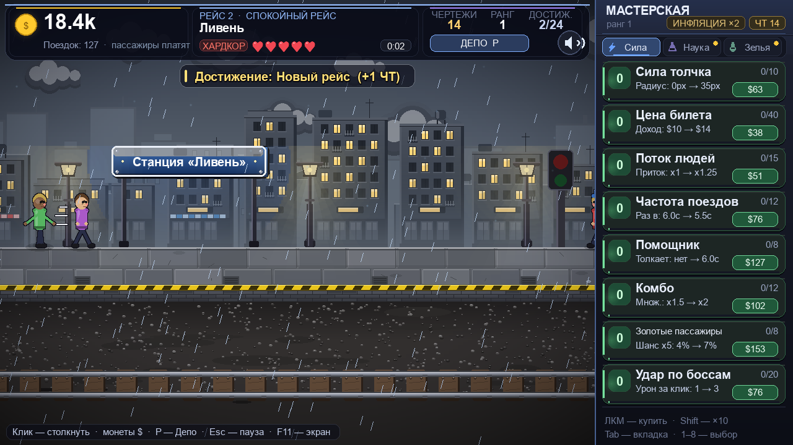
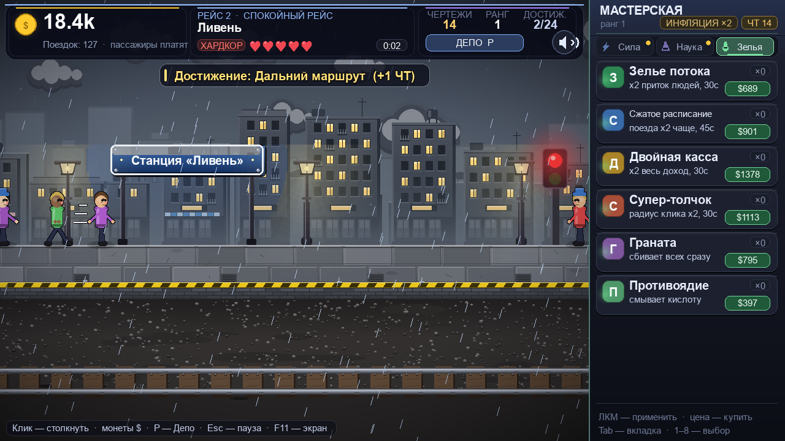
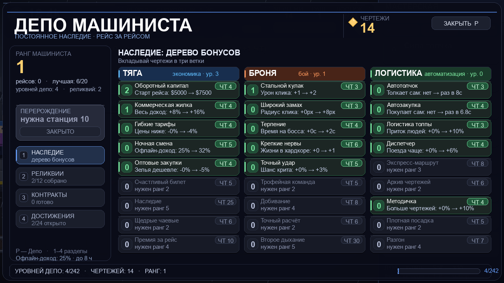
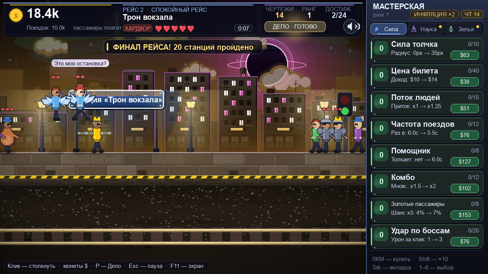

# ТАРАН-ЭКСПРЕСС

**Кликер-аркада на Python и Pygame.** Состав идёт по маршруту из 20 станций:
толчками сбиваешь пассажиров с платформы, покупаешь улучшения и зелья, между
забегами прокачиваешь «Депо» — дерево из 27 навыков, реликвии, контракты и
достижения. Есть десктопная версия, офлайн-APK для Android и PWA для установки
с сайта.




## Содержание

- [Возможности](#возможности)
- [Скриншоты](#скриншоты)
- [Быстрый старт](#быстрый-старт)
- [Структура репозитория](#структура-репозитория)
- [Проверки](#проверки)
- [Документация](#документация)
- [Мобильная сборка](#мобильная-сборка)
- [История версий](#история-версий)
- [Ограничения](#ограничения)
- [Лицензия](#лицензия)

## Возможности

| | |
|---|---|
| 🚉 **20 станций** | у каждой своя тема оформления, погода и босс; на 20-й рейс завершается победой |
| 👊 **Толчки и серии** | прямой и площадной удар, криты, поезда, кислота; 6 типов пассажиров со своим здоровьем и наградой |
| 🛠 **«Мастерская»** | 3 вкладки улучшений (тяга, броня, логистика), 6 расходников; `Shift` + клик покупает до 10 уровней сразу |
| 🏗 **«Депо»** | мета-прогресс: дерево из 27 узлов, 12 реликвий, контракты, 24 достижения, офлайн-доход и автоматизация |
| 🔁 **Перерождение** | после 10-й станции: чертежи, выбор одной из трёх реликвий и рост дохода в новом цикле |
| 📱 **Мобильная сборка** | офлайн-APK (CPython-WASM + pygame внутри) и PWA с service worker — игра работает без сети |

Контент целиком описан данными: `taran/config.py` (темы, боссы, улучшения,
предметы, скины) и `progression.py` (дерево, реликвии, контракты, достижения).

## Скриншоты

| Заставка | «Мастерская» |
|---|---|
|  |  |

| «Депо»: дерево навыков | Финал рейса |
|---|---|
|  |  |

## Быстрый старт

Нужен Python 3.12+ и `pygame-ce`:

```bash
git clone https://github.com/HBBoy102011/taran-express.git
cd taran-express
py -m pip install pygame-ce
py game.py
```

Сохранение создаётся автоматически рядом с игрой (`save.json`) и в репозиторий
не попадает.

### Управление

| Действие | Клавиша / мышь |
|---|---|
| Толчок по платформе | левая кнопка мыши |
| Купить до 10 уровней сразу | `Shift` + клик по карточке |
| Открыть/закрыть «Депо» | `P` |
| Вкладки «Депо» | `1`–`4` |
| Звук вкл/выкл | `M` |
| Пауза | `Esc` |
| Полный экран | `F11` |

## Структура репозитория

```text
game.py                 точка входа: окно, масштаб, события, сцена, главный цикл
progression.py          мета-прогресс: чертежи, дерево, реликвии, контракты, офлайн
prog_ui.py              реэкспорт HUD для старых импортов
taran/                  пакет движка (14 модулей)
  config.py             темы, боссы, улучшения, предметы, скины, баланс
  logic.py              цены, инфляция, пороги станций, геометрия интерфейса
  saves.py              чтение и запись save.json с миграцией старых сейвов
  world.py              фон, погода, станционные слои, переходы
  creatures.py          классы Person, Boss и подклассы боссов
  train.py              состав: движение, столкновения, отрисовка
  effects.py            частицы, всплывающий текст, монеты, декали, кислота
  assets.py             шрифты, звуки, кадры заставки
  audio.py              SoundKit: 18 эффектов, музыка станций и босса
  ui/                   theme.py, hud.py («Депо»), shop.py («Мастерская»)
test_smoke.py           дымовой тест игровой логики (19 проверок)
_meta_test.py           тест мета-прогресса (12 проверок)
sound/                  звуки и музыка игры
intro_frames/           кадры заставки
apk/                    AndroidManifest, MainActivity, иконка
mobile/                 сборка APK и PWA: game_app.py, build_apk.py, rebuild.py
docs/                   комплект проектной документации и презентация
docs_assignment/        сборка документов по заданию (python-docx, openpyxl)
Документация_Pygame_Серик_3-26п/
                        готовый комплект: 21 DOCX + 1 XLSX, схемы, скриншоты
db_schema/              ER-диаграмма и схема SQLite
ARCHITECTURE.md         карта модулей и план рефакторинга
pygbag.ini              что не паковать в веб-сборку
```

<details>
<summary>Что в репозиторий не попадает и почему</summary>

`android_sdk/`, `.apkbuild/`, `packages/`, `mobile/build/`, `mobile/cdn_cache/`
— инструменты и артефакты сборки, восстанавливаются командой
`py mobile/setup.py --fetch`. `music_src/` и `media_src/` — тяжёлые исходники
медиа (64 МБ). `save.json`, `__pycache__`, логи, бэкапы и черновики — личное и
временное. Полный список — в `.gitignore`.

</details>

## Проверки

```bash
py test_smoke.py                     # 19: толчки, пассажиры, поезда, магазин, сейв
py _meta_test.py                     # 12: дерево, реликвии, контракты, миграция
py docs/_tools/verify_content.py     # 33: весь контент, отрисовка, офлайн-доход
```

Все 64 проверки проходят. `verify_content.py` дополнительно пишет отчёт в
`docs/06_Тестирование/материалы/verify_report.json`.

## Документация

- **`Документация_Pygame_Серик_3-26п/`** — итоговый комплект по заданию:
  9 папок, 21 документ DOCX, книга тест-кейсов XLSX (30 кейсов, 12 дефектов),
  8 схем PNG + 8 файлов `.drawio`, 11 скриншотов и папка `09_Исходный_код`
  с копией кода для сверки.
- **`docs/`** — отдельный комплект проектной документации и презентация.
- **`ARCHITECTURE.md`** — как код разделён на модули и что дальше рефакторить.
- **`db_schema/`** — ER-диаграмма, DBML и готовая схема SQLite.

Пересборка комплекта (из корня проекта):

```bash
py docs_assignment/_build/build_all.py --diagrams --zip
py docs_assignment/_build/validate_package.py
```

## Мобильная сборка

```bash
py mobile/setup.py --fetch   # один раз: JDK, build-tools, рантайм pygbag
py mobile/rebuild.py         # APK + PWA -> mobile/build/
```

- **APK:** `mobile/build/TaranExpress_v3.2.apk` (~33 МБ), ставится копией файла,
  работает полностью офлайн. Подписан самоподписанным debug-ключом.
- **PWA:** `py mobile/serve_web.py 8099` → `http://127.0.0.1:8099/`. Для хостинга
  нужны HTTPS, MIME `.wasm` → `application/wasm` и заголовки
  `Cross-Origin-Opener-Policy` / `Cross-Origin-Embedder-Policy` (как в
  `serve_web.py`).

## История версий

**3.2** — единый тёмный интерфейс HUD, магазина и «Депо»; HUD разбит на три зоны
без наложений; переработанные вкладки со сводками и прогрессом; быстрая покупка
`Shift` + клик; компактный тост сверху; кэш спрайтов и буфер кадра для
стабильного FPS.

**3.1** — дерево выросло до 27 узлов; новые навыки в каждой ветке; миграция
сейвов 3.0; панель «Депо» на весь экран; шапка магазина без наездов;
ограничение числа эффектов и кэш сердечек.

**3.0** — перерождение и чертежи, дерево навыков, реликвии, контракты,
24 достижения, модификаторы рейса, офлайн-доход, модульная архитектура
(`taran/`), мобильная сборка APK и PWA.

## Ограничения

- `targetSdkVersion` в сборке — 33 при требовании Google Play 36, поэтому
  публикация в магазине заблокирована; ручная установка APK работает.
- Проверка APK и PWA на живых устройствах и юзабилити-сессии не оформлены
  протоколами — в тест-кейсах они честно помечены как не проведённые.
- Замер производительности (48,3 FPS, медиана кадра 18,37 мс) сделан в
  headless-режиме и не заменяет измерение на целевом устройстве.
- APK и веб-сборка в репозиторий не входят — их нужно собирать локально.

## Лицензия

Проект распространяется по лицензии [MIT](LICENSE): код можно свободно
использовать, изменять и распространять, сохраняя уведомление об авторских
правах. Авторские права — © 2026 Buffy (Codebuff).

## Автор

Серик Жанторе Батырханулы, группа 3-26п.
Учебный проект, версия 3.2, ноябрь 2026.
